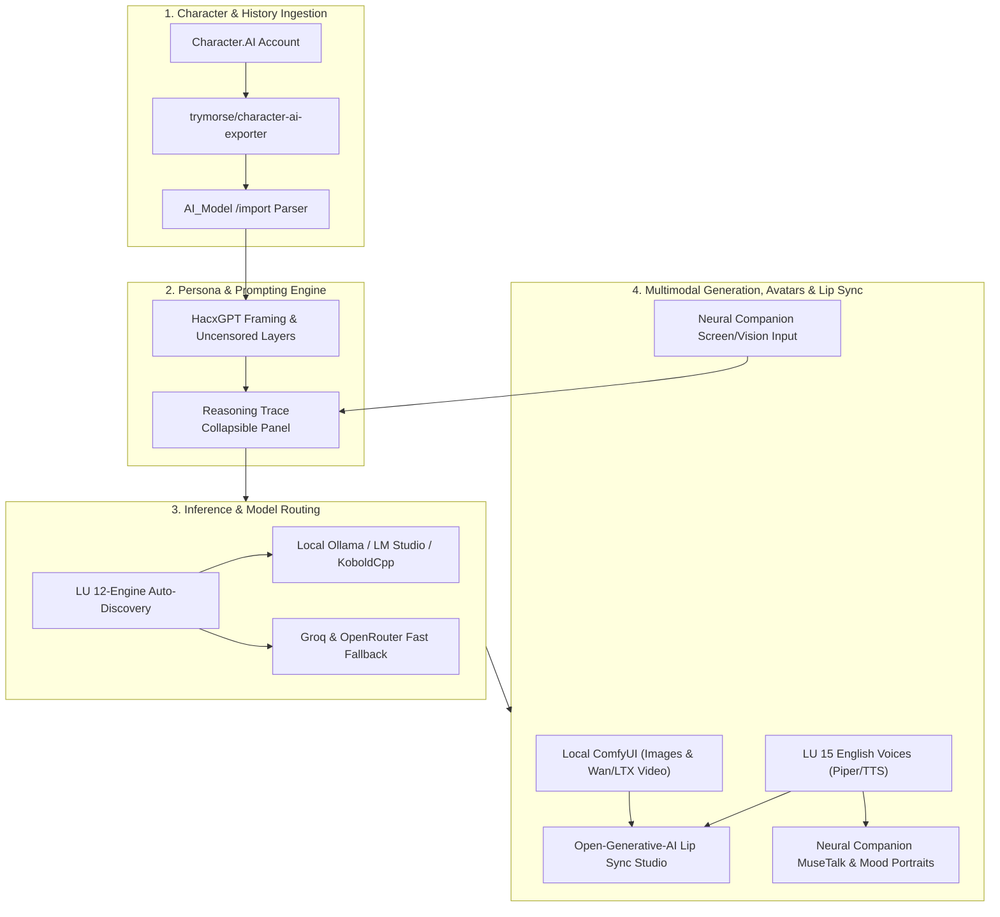

# Architectural & Implementation Plan: Character.AI Exporter & Multi-Engine Uncensored Studio

This document outlines the expanded architecture incorporating:
1. **[trymorse/character-ai-exporter](https://github.com/trymorse/character-ai-exporter)** (Account migration, character/chat ingestion)
2. **[Anil-matcha/Open-Generative-AI](https://github.com/Anil-matcha/Open-Generative-AI)** (Lip sync, video generation, 600+ model studio)
3. **[PurpleDoubleD/locally-uncensored](https://github.com/PurpleDoubleD/locally-uncensored)** (Local multi-engine discovery, abliterated model presets, ComfyUI video)
4. **[HacxGPT-Official/HacxGPT-CLI](https://github.com/HacxGPT-Official/HacxGPT-CLI)** (Zero-dependency provider routing, uncensored prompting frames, `<think>` reasoning traces)
5. **[Neural Companion](https://neuralcompanion.app/) / [Rakile/NeuralCompanion](https://github.com/Rakile/NeuralCompanion)** (Interactive avatars, MuseTalk, mood portraits, vision/screen awareness, Identity Relay)

---

## 1. Candidate Systems: Strengths & Improvements

### A. Neural Companion (`neuralcompanion.app` / `Rakile/NeuralCompanion`)
* **Key Strengths & Improvements**:
  - **Dynamic Mood Portraits & Visual Replies**: Automatically swaps character expressions and mood portraits (happy, bashful, serious, smiling) in real-time based on emotional cues/sentiment in the conversation.
  - **MuseTalk Real-Time Lip-Sync & 3D Tracking**: Real-time facial lip-sync animation driven by audio output, with optional VMC protocol integration to drive **VSeeFace** (3D VTuber models) or external avatars.
  - **Desktop Vision & Screen Awareness**: Vision source addons allow the companion to observe a selected window or screen in real-time, enabling contextual reactions to what you are browsing, playing, or coding.
  - **Identity Relay Continuity Protocol (`NC_IDENTITY_EXPORT`)**: Dedicated JSON continuity import protocol that extracts relationship memory, companion self-identity, and user bonds from any previous LLM chat.
  - **Discord Voice Bridge**: Allows bringing the imported character into live Discord voice channels or local rooms with push-to-talk, speaker turn taking, and interrupt recovery.

### B. Open-Generative-AI (`Anil-matcha/Open-Generative-AI`)
* **Key Strengths**:
  - **Talking Character Lip Sync (`LipSyncStudio`)**: Combines a static character avatar portrait + synthesized voice greeting to generate a synced talking head video (using Wan 2.2 S2V, Infinite Talk, or LatentSync).
  - **Video Studio Expansion (Text-to-Video & Image-to-Video)**: Adds 85+ T2V and 120+ I2V pipelines (Kling, Wan 2.6, Seedance, Hailuo, Sora 2, Veo).
  - **Multi-Image Character Consistency**: Up to 14 reference images per generation request to keep character face and clothing consistent across multiple scenes.
  - **Hybrid Local/Cloud Gateway**: Simple two-step async job submission (`POST /submit` -> poll `/result`) for video rendering that offloads massive compute when local VRAM is insufficient.

### B. Locally Uncensored (`PurpleDoubleD/locally-uncensored`)
* **Key Strengths**:
  - **12 Local Engine Auto-Discovery**: Automatically scans and connects to whichever local backend is running: Ollama, LM Studio, Jan, GPT4All, KoboldCpp, llama.cpp, vLLM, LocalAI, text-generation-webui, TabbyAPI, Aphrodite, or SGLang.
  - **Abliterated Model Registry & VRAM Fit Guide**: Preset catalog of uncensored weights where refusal behaviors have been removed from the weight tensors (e.g., `Qwen 3.8 27B Uncensored`, `Gemma 4 12B Heretic`, `Qwen3-VL 8B Abliterated`, `Llama 3.1 8B Abliterated`) with exact VRAM sizing badges.
  - **Local Offline ComfyUI Pipeline**: Desktop-integrated workflows for AnimateDiff Lightning, FramePack F1, and Wan 2.1/2.2 without requiring cloud access.
  - **15 Offline Character Voices**: 15 distinct English voice profiles and local Piper TTS integration.

### C. HacxGPT-CLI (`HacxGPT-Official/HacxGPT-CLI`)
* **Key Strengths**:
  - **Zero-Dependency Lightweight API Engine**: Direct streaming HTTP client routines bypassing bulky SDKs (`litellm`, `openai`) for reduced startup overhead and minimal latency.
  - **Multi-Provider Fallback Routing**: Seamless automatic routing between Local Ollama, Groq (ultra-fast LPU inference), and OpenRouter.
  - **Uncensored Roleplay Prompt Framing**: Advanced system framing layers that prevent false-positive refusals when interacting with cloud or semi-censored models.
  - **Chain-of-Thought `<think>` Rendering**: Dedicated UI collapsible panel for reasoning tokens and internal character monologue before replying in chat.
  - **Machine-Bound Encrypted Secret Vault**: Hardware-keyed local token storage (`~/.hacx`) to protect user API keys securely on-device.

---

## 2. Integrated System Architecture

---

## 3. Data Model & Migration Strategy

### 3.1 Character & Persona Hydration
* **From `character-ai-exporter`**:
  - Character cards, greetings, definitions (`{{char}}`), and avatars.
* **From `locally-uncensored`**:
  - Voice profiles (`Alba`, `Anna`, `Charles`, etc.) mapped to imported characters.
  - Model suggestions matched to local VRAM.
* **From `HacxGPT-CLI`**:
  - Reasoning trace handling: messages containing `<think>` or reasoning blocks are separated into a thoughts header and character response.
* **From `Open-Generative-AI`**:
  - Dynamic avatar generation (generating animated portraits or lip-synced greeting clips directly from the character's `voice_text`).

---

## 4. Phased Implementation Roadmap

### Phase 1: Core Character.AI Ingestion & Storage
- Backend endpoint `POST /api/lu/cai/import` to parse `morse.cai-export` files.
- Decode base64 avatars into `data/media/` and register in `ai_girls` table / `data/ai_girls.json`.
- UI `/import` page with character preview, selective checkboxes, and conversation history restore.

### Phase 2: Engine Expansion & HacxGPT Reasoning / Framing
- Adopt the **12-engine auto-discovery** logic from Locally Uncensored.
- Implement **HacxGPT reasoning trace `<think>` UI component** in `finch-local-chat`.
- Add multi-provider fallback (Local Ollama -> Groq / OpenRouter) with local encrypted key storage.

### Phase 3: Character Lip Sync & Generative Video Studio
- Integrate **Open-Generative-AI Lip Sync Studio**:
  - Input: Character portrait (`ai_girls.image_url`) + Voice audio (`ai_girls.voice_url`).
  - Output: Animated talking avatar greeting.
- Enable dual-mode image/video generation (Local ComfyUI or remote provider).

